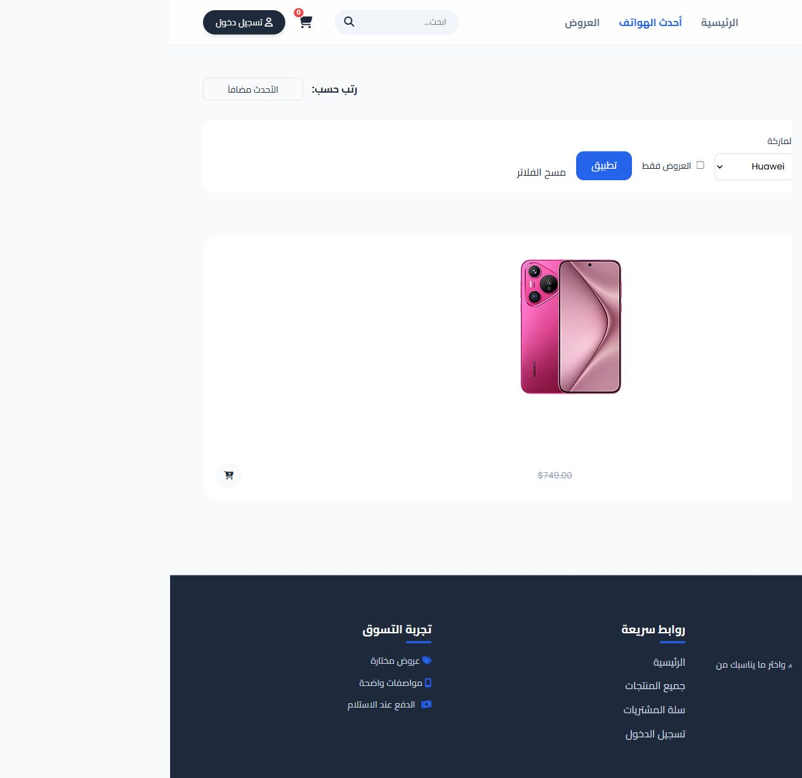
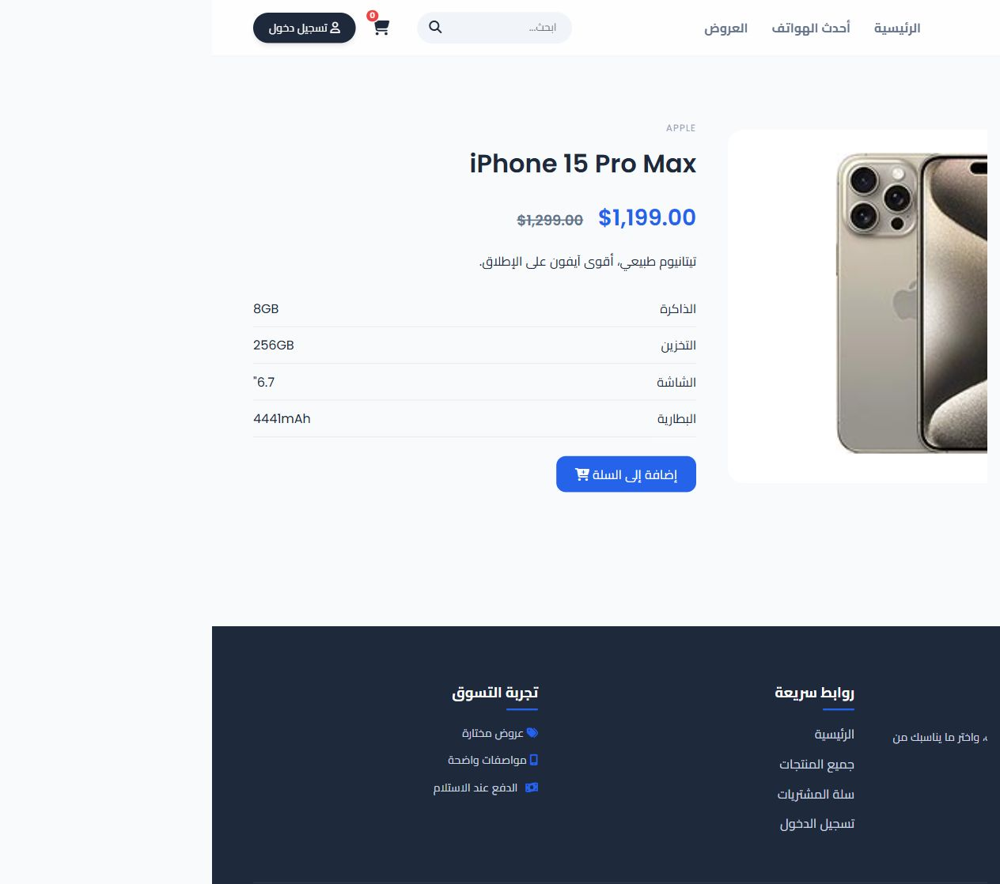
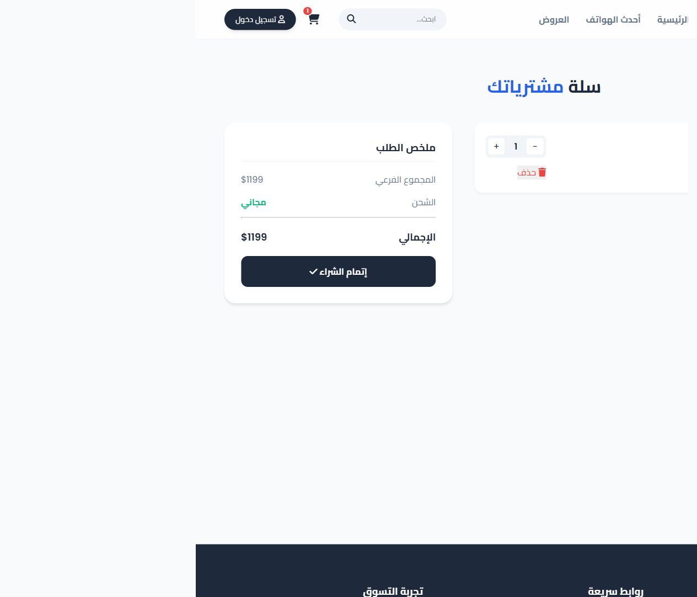
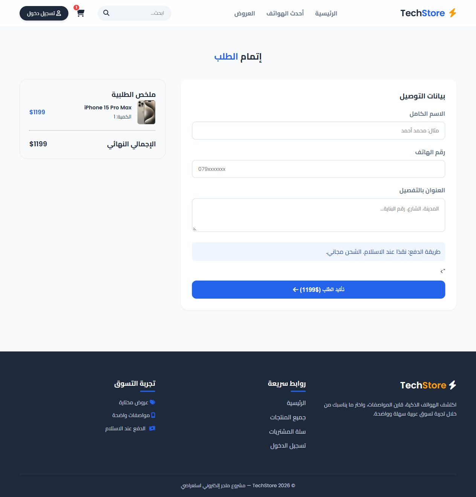
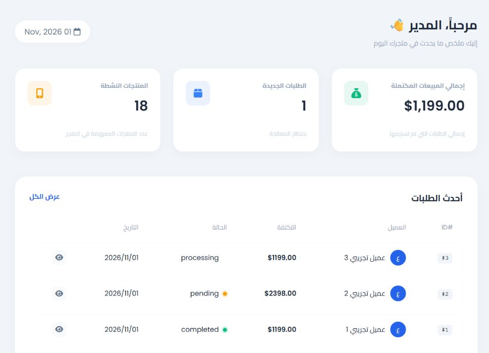
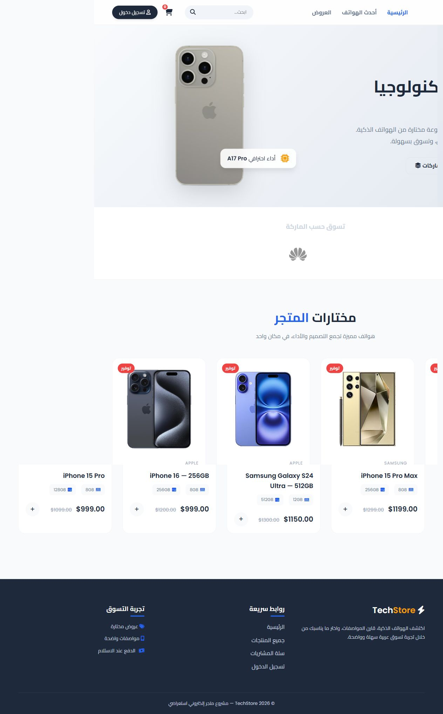

<div align="center">

# ⚡ TechStore

### Arabic smartphone store · Full-stack PHP portfolio project

A responsive RTL shopping experience, from product discovery to order management.


[العربية](docs/README.ar.md) · [Screenshots](#screenshots) · [Quick start](#quick-start) · [Architecture](docs/ARCHITECTURE.md)

</div>


## Overview

TechStore is a server-rendered smartphone storefront built with PHP, PDO, and MariaDB. It demonstrates the complete shopping flow: browsing and filtering a catalog, inspecting specifications, managing a cart, placing a cash-on-delivery order, and handling that order in an administrator dashboard.

The public dataset contains **18 products across 5 brands**: Apple, Samsung, Huawei, Xiaomi, and Google. Prices are demonstration values. Included sample orders are fictional. No real customer records, account passwords, or administrator credentials are distributed.

## Features

| Storefront | Administration |
| --- | --- |
| Responsive Arabic RTL layout | Administrator authorization checked against the database |
| Search, brand filters, offers, and sorting | Create, edit, and delete products |
| Product descriptions and specifications | Edit descriptions, memory, storage, screen, and battery fields |
| Session cart with quantity controls | Browse orders and update their status |
| Server-calculated checkout totals | Browse and delete customer accounts |
| Cash-on-delivery orders and printable receipts | Completed sales, pending orders, and catalog statistics |

## Screenshots

All screenshots were captured from the running application using an isolated demonstration database.

| Catalog & filters | Product details |
| --- | --- |
|  |  |

| Shopping cart | Checkout |
| --- | --- |
|  |  |

### Administration dashboard



<details>
<summary>View the complete homepage</summary>



</details>

## Tech stack

- **Backend:** PHP 8.2+, PDO prepared statements, server-rendered templates.
- **Database:** MariaDB 10.4-compatible SQL, InnoDB tables and foreign keys.
- **Frontend:** HTML5, CSS3, small JavaScript enhancements, Font Awesome.
- **Development:** XAMPP, PowerShell launch scripts, a PHP HTTP integration suite.

No Composer, npm, or frontend build step is required.

## Quick start

### Windows / XAMPP

Requirements: Windows PowerShell or PowerShell 7, XAMPP installed at `C:\xampp`, and free local ports **8000** and **3310**. Enable PHP extensions `pdo_mysql`, `mbstring`, and `curl` (curl is used by the test suite).

1. Clone or download the repository, then open PowerShell in its root folder.
2. Initialize the local application:

   ```powershell
   .\Initialize-Store.ps1
   ```

   This creates a private MariaDB data directory, random database credentials, the schema, the public demonstration catalog, and three fictional sample orders. Existing application data is preserved on subsequent runs.

3. Open [http://127.0.0.1:8000/](http://127.0.0.1:8000/).
4. Create your own administrator account:

   ```powershell
   C:\xampp\php\php.exe tools\setup-admin.php your-email@example.com
   ```

   A random password is saved to **`.runtime/admin-login.txt`**. Keep that file private. No account is shipped with a fixed password. Existing accounts are not changed by this command.

For later sessions:

```powershell
.\Start-Store.ps1
```

The application uses a restricted database account with `SELECT`, `INSERT`, `UPDATE`, and `DELETE` permissions inside its own database. Its local settings live outside the web root in `.runtime/database.json`.

### Manual setup / another operating system

1. Create an empty MySQL/MariaDB database with `utf8mb4` encoding.
2. Import `database/schema.sql`, then `database/seed.sql` into that database.
3. Create an application database user with data-access privileges; schema administration should remain separate.
4. Set these environment variables in the shell that starts PHP:

   ```text
   DB_HOST=127.0.0.1
   DB_PORT=3306
   DB_NAME=tech_store
   DB_USER=your_application_user
   DB_PASSWORD=your_private_password
   ```

   `.env.example` documents the variables; PHP does not automatically load `.env` files.

5. Start the application from the repository root:

   ```sh
   php -S 127.0.0.1:8000 -t public
   ```

6. In a shell with the same connection settings, create an administrator:

   ```sh
   php tools/setup-admin.php your-email@example.com
   ```

## Validation

The HTTP integration suite has **69 passing local checks**, covering registration, login, duplicate emails, combined catalog filters, product pages, cart controls, server-calculated orders, administration, CSRF rejection, login throttling, and database privileges.

For the automated XAMPP setup, run the local server first, then:

```powershell
C:\xampp\php\php.exe tests\smoke.php
```

The suite uses the private local administrative connection to set up and remove temporary test records. Run it on a development database. It cleans its test records in a `finally` block; auto-increment counters may advance. The GitHub workflow performs PHP syntax checks; it does not claim to run the database integration suite.

## Security decisions

- Parameterized SQL and validation of identifiers, quantities, prices, and order statuses.
- CSRF tokens on state-changing forms and POST requests.
- HTML escaping for database and user-generated content.
- Passwords hashed with `password_hash`. Session IDs rotate after authentication. Cookies use HttpOnly and SameSite=Lax, with Secure enabled under HTTPS.
- Database-backed login throttling: five attempts per email/IP pair in 15 minutes.
- Transactional order creation with prices loaded from the database.
- Database verification of current administrator permissions.
- Protected administrator accounts and foreign-key protection for ordered products.
- Private configuration, database files, logs, and backups excluded from the repository and release ZIP.

## Project structure

```text
public/        Public PHP application and static assets
  admin/                Administration pages
  images/products/      Local product images and source attribution
  bootstrap.php         Sessions, CSRF, validation, shared helpers
  config.php            PDO connection and environment overrides
database/               Public schema and sanitized demonstration seed
docs/                   Arabic guide, architecture, and screenshots
tests/                  HTTP integration suite
tools/                  Local setup and administrator creation
Initialize-Store.ps1     First-time local setup
Start-Store.ps1          Start the existing local application
Backup-Store.ps1         Create a private database backup
```

## Backups and deployment notes

```powershell
.\Backup-Store.ps1
```

Backups are stored in the ignored `backups/` directory. The PHP built-in server is intended for local demonstrations. A public deployment needs a production PHP web server, HTTPS, private environment configuration, and a document root pointing **only to `public`**. GitHub Pages cannot execute PHP or host the database.

Payment is cash on delivery. The planned roadmap includes Stripe test-mode payments, password reset, order emails, image uploads, and catalog pagination.

## Credits

**Project author:** [Yousef Qawasmi](https://github.com/yousefqawasmi599-sys).

Product and brand imagery belongs to its respective owners. Third-party images are used to demonstrate the catalog; source references are recorded in [THIRD_PARTY_NOTICES.md](THIRD_PARTY_NOTICES.md). The public repository contains no personal administrator email or credentials.


## License

The project code is available under the [MIT License](LICENSE). Third-party assets retain their respective terms.
