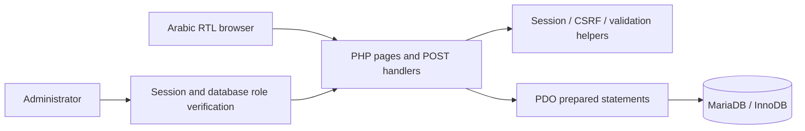
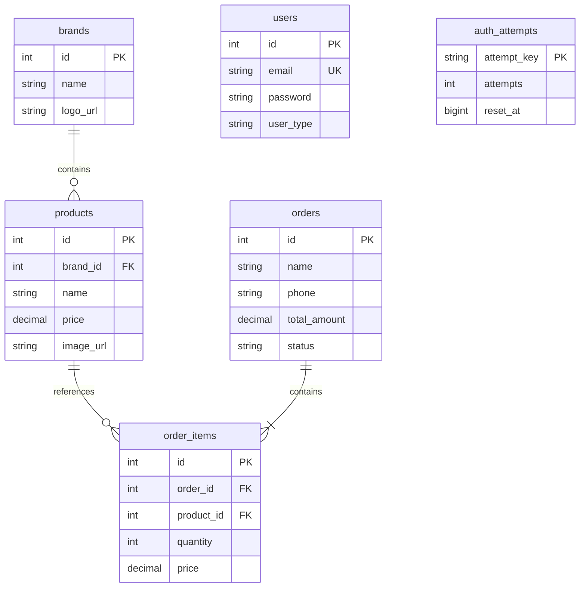

# Architecture

TechStore uses PHP templates and PDO without a framework or frontend build system.

## Data model

Orders support guest checkout: contact details belong to the order, so there is no user foreign key. Each line stores its price at purchase time. Administrator access relies on `user_type`; the legacy `role` column remains for compatibility with the original schema.

## Order creation

`place_order.php` validates delivery data, opens a transaction, reads and locks the current product records, computes the total in cents, inserts the order and its lines, then commits. It only clears the cart after success. The browser's submitted total is never trusted.

## Public/private boundary

Serve only `public`. `.runtime`, `backups`, tests, tooling, and SQL scripts belong outside the document root. The release archive is built from an explicit list of public project paths; private data is not copied.

## Screenshots

Screenshots were captured from the actual application using an isolated database initialized from `database/schema.sql` and `database/seed.sql`. Customer names, phone numbers, and orders shown there are fictional.
